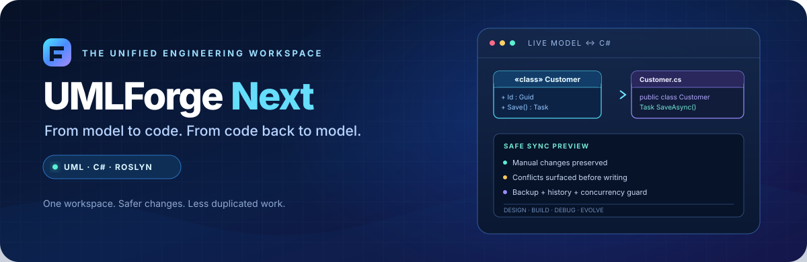
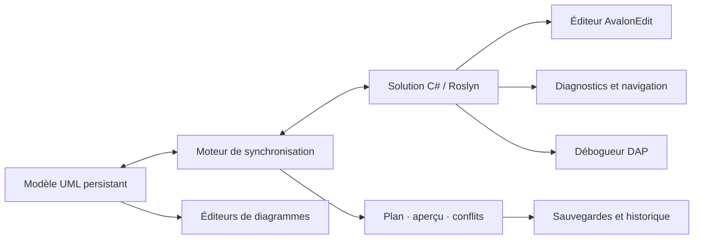

<div align="center">



# ◈ UMLForge Next
### **Un seul atelier. Du modèle au code. Sans refaire deux fois le travail.**

<p><strong>UML · C# / .NET · Roslyn · Synchronisation bidirectionnelle · Débogage DAP</strong></p>

<p>
  
  
  
  
  
</p>

**Imagine un diagramme UML qui évolue avec ton code C# — et un code C# qui reste lié à son modèle.**

UMLForge Next est un environnement Windows en construction qui rassemble la modélisation UML, l'analyse de solutions .NET, les outils d'édition C# et une synchronisation prudente UML ↔ code. L'ambition est de réunir, progressivement, les forces d'un atelier UML spécialisé et d'un IDE moderne dans un même espace de travail.

</div>

---

## ✦ L'expérience visée

<table>
<tr>
<td width="33%" valign="top">
<h3>◇ Modéliser</h3>
Créer des diagrammes, définir des éléments et des relations, documenter le modèle et exécuter des contrôles de cohérence propres aux vues UML.
</td>
<td width="33%" valign="top">
<h3>⌘ Développer</h3>
Éditer le C#, explorer une solution .NET, obtenir des suggestions Roslyn, analyser les diagnostics, naviguer vers les symboles et refactoriser avec précaution.
</td>
<td width="33%" valign="top">
<h3>⇄ Synchroniser</h3>
Comparer le code généré et le code manuel, prévisualiser les changements, préserver le travail existant et rendre les conflits visibles avant application.
</td>
</tr>
</table>

> **Promesse centrale :** réduire au maximum le travail en double entre conception et implémentation, tout en conservant le contrôle du développeur sur chaque modification risquée.

## ✨ Ce qui est présent dans cette version

### 01 · Atelier de modélisation UML

- Registre de **14 familles de diagrammes UML** : classes, cas d'utilisation, séquence, activité, composants, déploiement, états, paquetages, objets, communication, timing, structure composite, vue d'interaction et profils.
- Canevas avec éléments déplaçables, liens, inspecteur et propriétés.
- Métadonnées : visibilité, stéréotypes, contraintes, gardes, multiplicités, durées et marqueurs abstrait/statique.
- Catalogue central des types d'éléments et de relations attendus par diagramme.
- Contrôles de cohérence par diagramme et au niveau du projet : identifiants, noms, références orphelines, multiplicités, types C# des éléments, signatures dupliquées, cycles de généralisation et cohérence des paquetages.
- Export de diagrammes en PlantUML et JSON.
- Métamodèle sémantique enrichi : classes, interfaces, énumérations, acteurs, cas d'utilisation, composants, nœuds/artefacts de déploiement, signaux, machines à états, activités, interactions, lignes de vie, messages et fragments combinés.
- Inventaire de métaclasses inspiré de UML 2.5.1, organisé par familles, pour suivre explicitement la couverture et les éléments encore à implémenter.
- Interpréteur OCL sécurisé pour un sous-ensemble utile d'invariants : booléens, propriétés de `self`, comparaisons, opérations arithmétiques, logique et `size()/isEmpty()/notEmpty()` sur collections/chaînes.

### 02 · Atelier C# / .NET

- Éditeur AvalonEdit avec coloration syntaxique, numéros de ligne, recherche, remplacement et formatage.
- Explorateur de fichiers et commandes de création, restauration, compilation, tests, exécution et gestion de packages NuGet.
- Workspace Roslyn utilisant MSBuild pour ouvrir une solution `.sln` ou un projet `.csproj`.
- Diagnostics de compilation avec projet, fichier, ligne et colonne.
- **Popup de complétion sémantique** dans l'éditeur : `Ctrl+Espace`, navigation au clavier et insertion par Entrée.
- Renommage sémantique de symboles à travers les documents de la solution, avec confirmation et sauvegardes.
- Passerelle d'identité UML ↔ Roslyn : action **Mapper UML ↔ C#** pour les classes, propriétés, opérations, interfaces, énumérations et littéraux d’énumération (ainsi que les signaux/attributs et types primitifs compatibles). Elle conserve les GUID, enregistre l’élément qualifié, le projet, le fichier et une empreinte structurelle ; traite les classes `partial` via les symboles Roslyn fusionnés ; tente une reconnaissance prudente de certains renommages et marque les ambiguïtés au lieu de deviner. Une sauvegarde du modèle est créée avant l’écriture.
- Navigation vers la définition (`F12`) et recherche des références d'un symbole.
- Signature help pour les appels et constructeurs reconnus par Roslyn.
- Suggestions d'import automatique fondées sur les types manquants et les symboles des références du projet ; l'ajout reste soumis à confirmation.
- Actions de code sûres de base : formatage, tri des `using`, ajout d'import et suppression proposée de `using` inutilisés.
- Panneau de diagnostics du fichier avec navigation vers la ligne et la colonne concernées.
- Tri initial des directives `using` avec aperçu/confirmation.

### 03 · Synchronisation UML ↔ C#

- Plan de synchronisation avant écriture.
- Comparaison avec une baseline, détection de changements et détection prudente de certains conflits.
- Fusion syntaxique à trois voies pour des modifications indépendantes de membres C# reconnus.
- Détection de certains renommages/déplacements possibles et traitement explicite des suppressions.
- Choix par fichier, contrôle de concurrence par hash, sauvegardes et historique.
- Préférence pour la conservation du code manuel en cas d'ambiguïté : aucun conflit ne devrait être écrasé silencieusement.

### 04 · Débogueur graphique DAP

- Démarrage d'une cible .NET en configuration Debug avec un adaptateur DAP compatible.
- Points d'arrêt par ligne et **conditions simples** au format `25?count > 3`.
- Continuer, pause, pas à pas, entrer dans une fonction et en sortir.
- Consultation de la pile d'appels, variables locales/Autos, liste des threads et évaluation d'expressions Watch.
- Journal des événements du protocole pour diagnostiquer les problèmes de l'adaptateur.

### 05 · Sauvegarde et prudence

- Sauvegardes avant les opérations de renommage sémantique et de synchronisation.
- Aperçu et confirmation avant certaines écritures multi-fichiers.
- Vérification que les fichiers n'ont pas changé entre l'aperçu et l'application.
- Tests automatisés pour des cas importants de fusion, suppression, renommage potentiel, validation UML et évaluation du sous-ensemble OCL.
- Workflow GitHub Actions pour compiler et tester sous Windows.

---

## 🧭 Vue d'ensemble de l'architecture



```text
UMLForge-Next/
├── UMLForge/                  # Application Windows WPF
│   ├── Models/                # Modèle UML et éléments sémantiques
│   ├── Services/              # UML, Roslyn, génération, merge et DAP
│   ├── MainWindow.xaml        # Fenêtre principale
│   ├── DiagramManagerWindow.* # Atelier de diagrammes
│   ├── CodeWorkspaceWindow.* # Éditeur C# / environnement .NET
│   └── GraphicalDebuggerWindow.*
├── UMLForge.Tests/            # Tests unitaires
├── Docs/                      # Architecture, couverture et plans de test
├── Scripts/                   # Compilation et publication Windows
└── .github/workflows/         # CI Windows
```

## 🚀 Démarrage rapide — Windows

### Prérequis

- Windows 10 ou Windows 11.
- SDK **.NET 10** et accès aux packages NuGet.
- Outils MSBuild nécessaires aux projets chargés.
- Pour le débogage : adaptateur DAP compatible .NET (par exemple `netcoredbg`) installé séparément, DLL Debug et symboles PDB.

### Compiler et tester

Ouvre PowerShell dans le dossier du dépôt :

```powershell
cd UMLForge

dotnet --info
dotnet restore UMLForge.sln
dotnet build UMLForge.sln -c Release
dotnet test UMLForge.sln -c Release
# Ou lancer le contrôle de référence complet sous PowerShell :
..\Scripts\Validate-Windows.ps1
```

Pour lancer l'application après une compilation réussie :

```powershell
dotnet run --project UMLForge.csproj
```

> Si tu ouvres un projet qui cible une autre version du SDK ou qui dépend de workloads particuliers, installe les composants requis par ce projet. Roslyn utilise les références réellement résolues par MSBuild ; une restauration échouée dégrade aussi l'analyse sémantique.

### Raccourcis et actions utiles

| Action | Utilisation |
|---|---|
| Complétion Roslyn | `Ctrl+Espace` dans un fichier C# d'une solution chargée |
| Aller à la définition | `F12` ou bouton **Définition F12** |
| Rechercher les références | Bouton **Références** |
| Trier les `using` | Bouton **Trier using**, avec confirmation |
| Analyse de solution | **Analyser solution** |
| Signature help | Bouton **Signature help** dans un appel/constructeur |
| Imports automatiques | **Imports auto**, puis choisir un espace de noms proposé |
| Actions de code | **Actions de code**, puis choisir et confirmer une transformation |
| Diagnostics du fichier | **Diagnostics fichier**, puis sélectionner une ligne pour naviguer |
| Renommer un symbole dans la solution | **Renommer sémantique** |
| Associer les GUID UML aux symboles C# | **Mapper UML ↔ C#**, choisir le fichier `.umlforge.json`, consulter le rapport (renommages/ambiguïtés inclus) et confirmer la sauvegarde |
| Aperçu de synchronisation | **Sync UML ↔ C#** |
| Condition de point d'arrêt | `25?count > 3` dans la liste des points d'arrêt |
| Watch | Saisir une expression puis **Évaluer Watch** lorsque l'exécution est en pause |

---

## 📊 État réel — transparence avant tout

| Domaine | Niveau actuel | Ce qu'il faut encore faire |
|---|---|---|
| Métamodèle UML | Modèle sémantique enrichi et catalogue de métaclasses UML 2.5.1 | Implémentation normative exhaustive, sérialisation/XMI complète et sémantique de toutes les métaclasses |
| Notations et diagrammes | 14 familles cataloguées, canevas et contrôles | Éditeurs spécialisés complets, notation exacte, fragments, ports, interactions et règles de chaque métaclasse |
| Validation UML | Règles de cohérence projet/diagrammes et interpréteur OCL limité | OCL complet de la spécification, collections/itérateurs exhaustifs, opérations standard et suite complète de conformité OMG |
| IntelliSense C# | Popup sémantique, signature help, suggestions d'imports et panneau de diagnostics | Parité avec l'IntelliSense Visual Studio, filtrage/insertion avancés, snippets, analyseurs et actions de code exhaustives |
| Navigation | Définition et références Roslyn | Hiérarchie d'appels, implémentations, navigation entre symboles externes et indexation incrémentale |
| Refactorisations | Renommage sémantique de solution, formatage, tri/imports et nettoyage de `using` | Extraction, encapsulation, safe delete, transformations multi-projets et couverture complète des CodeFixProviders Roslyn |
| Débogage | DAP, points d'arrêt conditionnels simples, Watch, Autos/Locals, threads | Breakpoints visuels dans la marge, exceptions, hit conditions avancées, attach, hot reload, inspection approfondie et validation multi-adaptateurs |
| Synchronisation | Aperçu, baseline, hash, historique, fusion syntaxique prudente et mapping GUID de classes/membres/types supportés vers symboles Roslyn | Couverture de tous les éléments UML, résolution des renommages structurels ambigus, refactorisations structurelles et tests de restauration transactionnelle |
| Qualité | Tests unitaires et workflow CI ajoutés | Compilation Windows réelle, exécution des tests, tests UI et validation sur projets .NET réels |
| Parité logicielle | Architecture de convergence | Vérification fonctionnalité par fonctionnalité par rapport aux produits de référence |

### Important

UMLForge Next **n'a pas encore la parité fonctionnelle complète** avec Visual Studio Community, StarUML ou Visual Paradigm. Le catalogue est plus étendu, mais ne constitue pas une implémentation intégrale de la norme UML 2.5.1. Les actions de code disponibles forment une sélection utile, sans remplacer l’ensemble des actions et refactorisations de Visual Studio Community. La liste des diagrammes n'implique pas que toutes leurs notations, règles, extensions, générateurs, intégrations ou fonctions spécialisées soient déjà implémentés. Les fonctions DAP dépendent aussi des capacités de l'adaptateur installé.

Cette archive vise maintenant une version de référence consolidée : priorité à la validation Windows, à la correction des éventuelles régressions et à la publication GitHub, plutôt qu’à l’ajout de nouvelles fonctionnalités. La compilation et les tests Windows doivent réussir avant de considérer cette version comme validée. Le catalogue de métaclasses sert de manifeste de couverture ; il ne signifie pas que chaque métaclasse est déjà représentée avec toute sa sémantique. Le moteur OCL évalue un sous-ensemble sûr et documenté, pas toute la grammaire et la bibliothèque standard OCL.

---

## 🛠️ Prochain cycle de travail

1. **Conformité UML** — compléter le métamodèle, les identités persistantes, les règles par diagramme et les tests de référence ; étendre l'évaluateur OCL jusqu'à la couverture normative.
2. **Expérience IDE C#** — perfectionner la popup IntelliSense, les signatures, les actions de code, les diagnostics dans l'éditeur, la navigation et les refactorisations Roslyn.
3. **Débogueur** — fiabiliser le cycle DAP, ajouter les fenêtres Autos/Locals/Watch/Threads/Exceptions et valider les breakpoints sur des applications .NET réelles.
4. **Synchronisation** — étendre le mapping GUID UML ↔ symboles Roslyn aux propriétés, opérations, interfaces et énumérations ; gérer les renommages, suppressions, fichiers `partial`, namespaces et conflits structurels.
5. **Qualité de livraison** — exécuter build et tests sur Windows, corriger chaque erreur, tester l'installation et publier une matrice de couverture reproductible.
6. **Préparation GitHub** — versionner les décisions d'architecture, les règles, les tests, les issues et les changements ; ne revendiquer que les capacités vérifiées.

## 📚 Documentation

- [`Docs/ARCHITECTURE.md`](Docs/ARCHITECTURE.md) — architecture et frontières des composants.
- [`Docs/ROADMAP.md`](Docs/ROADMAP.md) — jalons et priorités.
- [`Docs/STATUS-REAL.md`](Docs/STATUS-REAL.md) — état réel des fonctions.
- [`Docs/TEST-PLAN.md`](Docs/TEST-PLAN.md) — stratégie de validation.
- [`Docs/UML-COVERAGE.md`](Docs/UML-COVERAGE.md) — catalogue UML, règles et limites.
- [`Docs/CODE-EDITOR.md`](Docs/CODE-EDITOR.md) — Roslyn, navigation et IntelliSense.
- [`Docs/DEBUGGER.md`](Docs/DEBUGGER.md) — configuration DAP, points d'arrêt et Watch.
- [`Docs/SYNCHRONIZATION.md`](Docs/SYNCHRONIZATION.md) — baseline, merge, conflits et sauvegardes.
- [`Docs/RELEASE-CHECKLIST.md`](Docs/RELEASE-CHECKLIST.md) — contrôles avant le premier push et la première release.
- [`CHANGELOG.md`](CHANGELOG.md) — changements de cette version de travail.
- [`CONTRIBUTING.md`](CONTRIBUTING.md) — règles de contribution.
- [`SECURITY.md`](SECURITY.md) — principes de sécurité et signalement.

---

<div align="center">

### ◈ Concevoir avec précision. Coder avec intelligence. Synchroniser avec confiance.

**UMLForge Next** — un atelier en évolution, construit autour d'une idée simple : le modèle et le code doivent travailler ensemble.

</div>
